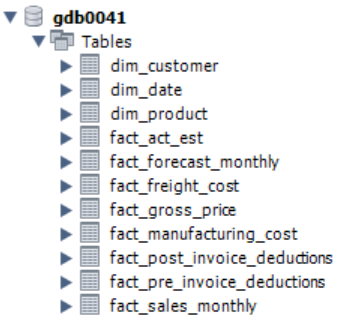
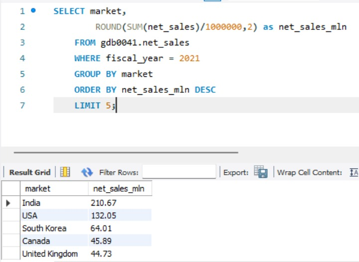
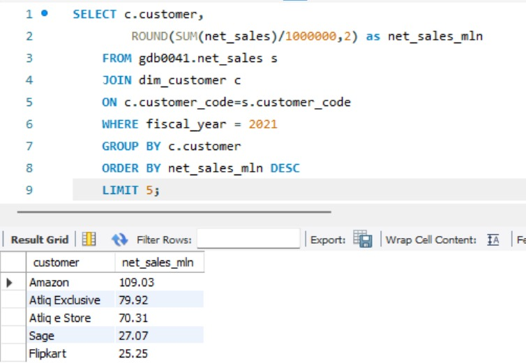
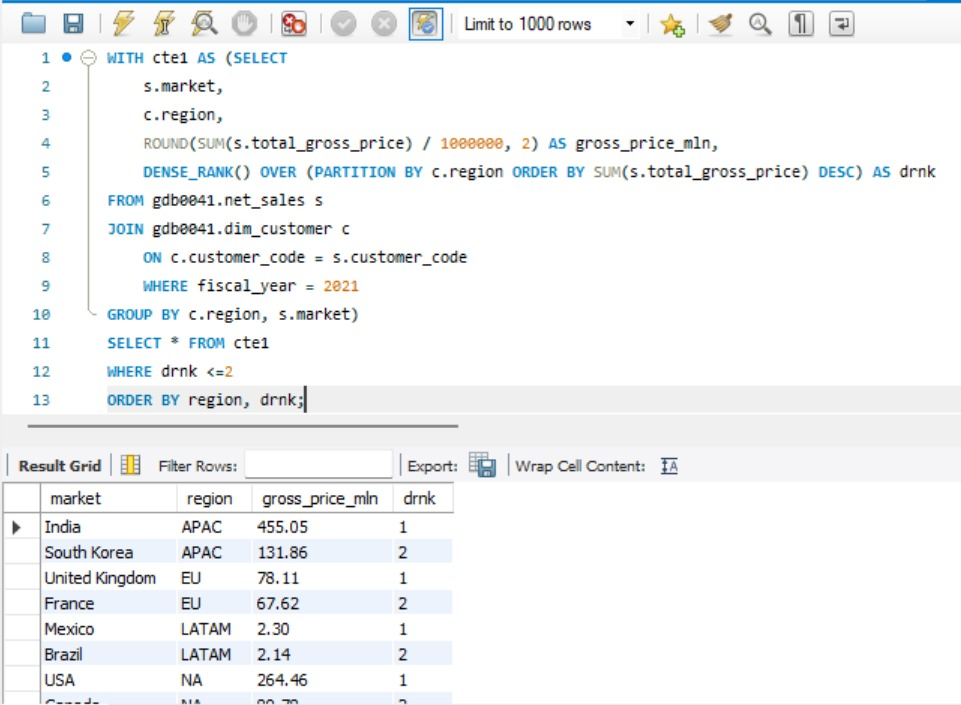
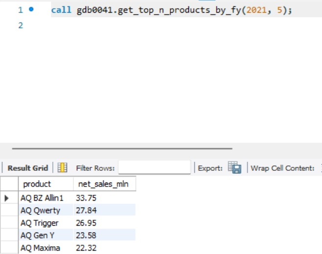
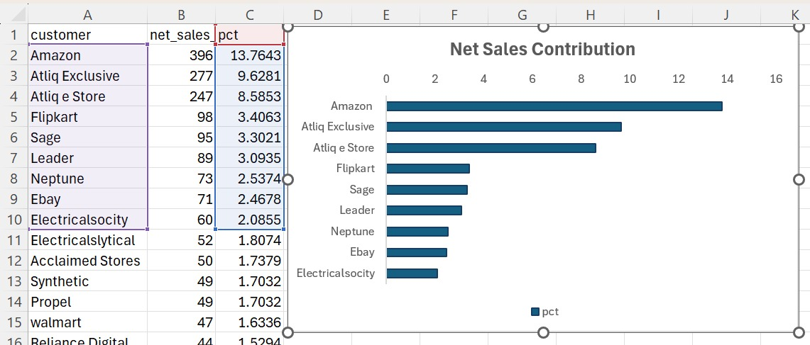
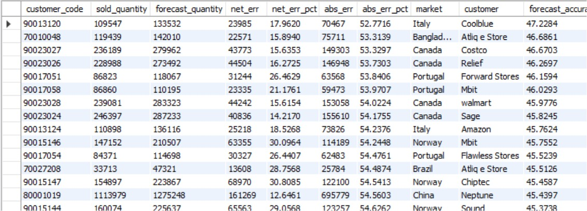

<p align="center">
  
</p>

<p align="center">
  <a href="#context"><b>Context</b></a> &nbsp;·&nbsp;
  <a href="#journey"><b>Journey</b></a> &nbsp;·&nbsp;
  <a href="#insights"><b>Insights</b></a> &nbsp;·&nbsp;
  <a href="#requests"><b>Requests</b></a> &nbsp;·&nbsp;
  <a href="#model"><b>Data Model</b></a> &nbsp;·&nbsp;
  <a href="#run"><b>Run It</b></a> &nbsp;·&nbsp;
  <a href="docs/query_walkthrough.md"><b>Full Walkthrough →</b></a>
</p>

> **In one line:** I turned AtliQ Hardware's raw sales, pricing and forecast tables into a reusable MySQL analytics layer (functions, views, stored procedures) and used it to answer **9 real business requests**, each with the query, the output screenshot and the answer.

<a id="context"></a>

## 🏢 Business Context

**AtliQ Hardware** sells PCs, peripherals and storage worldwide through retailers, e-commerce platforms and its own direct channels (**Atliq Exclusive** and **Atliq e Store**). Sales, finance, key-account and supply-chain teams all depend on the same data, and each asks different questions:

| Team | Question |
|---|---|
| Sales | How much did a key customer buy, by year, quarter and month? |
| Leadership | Which markets, customers and products drive net revenue? |
| Finance | How much of gross sales survives discounts, and who contributes what share? |
| Supply Chain | How accurate are our demand forecasts, and where did they get worse? |

> 📌 **Fiscal year:** AtliQ's fiscal year starts in **September**. FY2021 runs from Sep 2020 to Aug 2021.

<a id="journey"></a>

## 🧭 The Project Journey

The project was built in phases, and each phase fixed a problem found in the one before.

| Phase | What happened | Why |
|:-:|---|---|
| **0** | Explored the 11 tables of `gdb0041` | Understand dimensions vs facts |
| **1** | **Fresh start:** first Croma request and customer lookup | Sales are stored by calendar month, prices by fiscal year |
| **2** | Built `get_fiscal_year()` and `get_fiscal_quarter()` | Fiscal logic written once, reused everywhere |
| **3** | **Change:** added a generated `fiscal_year` column | Faster than calling a function on every row |
| **4** | Turned the monthly report into a **stored procedure** | A one-off query becomes a self-service tool |
| **5** | Built three layered views (v1, improved v2, post-invoice, net sales) | Net-sales logic written once, no repeated joins |
| **6** | Top markets, customers, share %, regional ranking, top products | Leadership questions on top of `net_sales` |
| **7** | Forecast accuracy, temp tables replaced by CTEs | Cleaner and safer, no copy-paste |
| **8** | Inventory of every object built | A complete, auditable analytics layer |

👉 Every phase, with before and after screenshots, is in the **[Query Walkthrough](docs/query_walkthrough.md)**.

<a id="insights"></a>

## 💡 Key Insights

| # | Finding | Number |
|:-:|---|---|
| 1 | **Croma India is scaling fast.** Gross sales FY2020 → FY2021 → FY2022 | $6.50M → **$23.22M** (+257%) → **$44.64M** (+92%) |
| 2 | **India is the #1 market** by net sales in FY2021, about 1.6× the USA | **$210.67M** vs $132.05M |
| 3 | **About half of gross sales never reaches net sales** after pre- and post-invoice deductions | India keeps ~**46%**, USA ~**50%** |
| 4 | **Revenue is concentrated.** Amazon leads FY2021, and the top 9 customers hold nearly half of net sales | Amazon **$109.03M**; top 9 = **48.9%** |
| 5 | **AtliQ's own channels outweigh Amazon.** Atliq Exclusive plus Atliq e Store | **~18.2%** vs Amazon 13.76% |
| 6 | **Best-selling products, FY2021:** AQ BZ Allin1, AQ Qwerty, AQ Trigger | **$33.75M**, $27.84M, $26.95M |
| 7 | **Forecasting has headroom.** The best customers reach only ~47% accuracy and all over-forecast (13 to 31%) | Excess-inventory risk |

<a id="requests"></a>

## 🎯 Business Requests

| # | Business request | Stakeholder | Key technique | Answer |
|:-:|---|---|---|:-:|
| 1 | Croma India yearly gross sales | Sales | Joins, custom function | [R1](docs/query_walkthrough.md#r1) |
| 2 | Croma transactions, fiscal Q1 FY2021 | Sales | Fiscal quarter function | [R2](docs/query_walkthrough.md#r2) |
| 3 | Monthly gross sales for any customers | Sales / Finance | **Stored procedure** | [R3](docs/query_walkthrough.md#r3) |
| 4 | Top 5 markets by net sales, FY2021 | Leadership | Layered views | [R4](docs/query_walkthrough.md#r4) |
| 5 | Top 5 customers by net sales, FY2021 | Key Accounts | Views and joins | [R5](docs/query_walkthrough.md#r5) |
| 6 | Each customer's % of net sales | Finance | **CTE + window function** | [R6](docs/query_walkthrough.md#r6) |
| 7 | Top 2 markets in every region | Regional Heads | **Ranking window function** | [R7](docs/query_walkthrough.md#r7) |
| 8 | Top N products for any year | Product Team | **Parameterised procedure** | [R8](docs/query_walkthrough.md#r8) |
| 9 | Customers whose forecast accuracy dropped | Supply Chain | CTEs and self-join | [R9](docs/query_walkthrough.md#r9) |

The SQL for each request is in [`sql/requests/`](sql/requests).

<a id="model"></a>

## 🗂 Data Model

Database **`gdb0041`** (provided by Codebasics for the AtliQ case study, not redistributed here) has **3 dimension tables** and **8 fact tables**.

<p align="center">
  <a href="images/27_db_tables.png"></a>
</p>

**How the analytics layer is built**

```
fact_sales_monthly + dim_customer + dim_product + fact_gross_price + fact_pre_invoice_deductions
          |
          v
  sales_pre_inv_discount        gross price and pre-invoice discount %
          |
          |   + fact_post_invoice_deductions
          v
  sales_pos_inv_discount        net invoice sales and post-invoice deductions %
          |
          v
  net_sales                     final net sales   --->   Requests R4 to R8

  fact_act_est                  actual vs forecast   --->   Forecast accuracy (R9)
```

**Revenue logic used throughout**

```
Gross Sales        = gross_price x sold_quantity
Net Invoice Sales  = Gross Sales x (1 - pre_invoice_discount_pct)
Net Sales          = Net Invoice Sales x (1 - post_invoice_discounts_pct)
```

## 🛠 SQL Skills Demonstrated

| Area | What was used |
|---|---|
| **Joins and aggregation** | Multi-table joins, `SUM`, `ROUND`, `GROUP BY` |
| **CTEs** | Layered, readable logic replacing temp tables |
| **Window functions** | `DENSE_RANK() OVER (PARTITION BY ...)`, `SUM() OVER ()` |
| **Views** | Three-layer view stack for net sales |
| **Stored procedures** | Parameterised reports (`IN` params, `FIND_IN_SET`) |
| **User-defined functions** | `get_fiscal_year()`, `get_fiscal_quarter()` |
| **Performance tuning** | Generated column instead of per-row function calls |
| **Data quality** | `NULLIF` guards against divide-by-zero |
| **Visualisation** | Excel bar chart of customer contribution |

## 🖼 Project Gallery

*Click any image to open it full size.*

<table>
  <tr>
    <td align="center" width="50%"><b>Top 5 markets, FY2021</b><br><br><a href="images/17_top5_markets_fy2021.jpeg"></a></td>
    <td align="center" width="50%"><b>Top 5 customers, FY2021</b><br><br><a href="images/18_top5_customers_fy2021.jpeg"></a></td>
  </tr>
  <tr>
    <td align="center" width="50%"><b>Top 2 markets per region</b><br><br><a href="images/21_top2_markets_per_region.jpeg"></a></td>
    <td align="center" width="50%"><b>Top 5 products (stored procedure)</b><br><br><a href="images/24_top_n_products_result.jpeg"></a></td>
  </tr>
  <tr>
    <td align="center" width="50%"><b>Customer contribution (Excel)</b><br><br><a href="images/20_customer_share_excel_chart.jpeg"></a></td>
    <td align="center" width="50%"><b>Forecast accuracy report</b><br><br><a href="images/26_forecast_accuracy_result.jpeg"></a></td>
  </tr>
</table>

## 📁 Repository Structure

```
AtliQ-Consumer-Goods-SQL-Analysis/
|-- README.md
|-- .gitignore
|-- docs/
|   `-- query_walkthrough.md       question, SQL, screenshot and answer for every request
|-- sql/
|   |-- setup/                     run first, in order
|   |   |-- 01_functions.sql
|   |   |-- 02_generated_column.sql
|   |   |-- 03_views.sql
|   |   `-- 04_stored_procedures.sql
|   `-- requests/                  one file per request (R01 to R09)
`-- images/                        screenshots, numbered in project order
```

<a id="run"></a>

## ▶️ How to Run

1. Import the **`gdb0041`** dataset from Codebasics into **MySQL 8.0 or later** (CTEs and window functions need 8.0).
2. Run the setup scripts **in order**:
   ```sql
   SOURCE sql/setup/01_functions.sql;
   SOURCE sql/setup/02_generated_column.sql;
   SOURCE sql/setup/03_views.sql;
   SOURCE sql/setup/04_stored_procedures.sql;
   ```
3. Run any file in `sql/requests/`, or follow the [walkthrough](docs/query_walkthrough.md).

## 👤 About the Author

**Muhammad Raheel Yousaf** · Aspiring Data Analyst · SQL · Excel · Power BI

<a href="https://github.com/mraheelyousaf4"></a>
<a href="https://www.linkedin.com/in/YOUR-LINKEDIN/"></a>
<a href="https://YOUR-PORTFOLIO-LINK"></a>

**Acknowledgement:** completed as part of the Codebasics Data Analytics Bootcamp (SQL, Consumer Goods domain). Dataset and business case by Codebasics.

<p align="center"><i>If this project helped you, consider giving it a ⭐</i></p>
