<h1 align="center">📖 Query Walkthrough</h1>

<p align="center"><b>How the project was built, step by step: where it started, what changed, and what it looks like after the changes.</b><br>
Every request follows the same pattern: <code>Question → Approach → SQL → Screenshot → Answer</code></p>

<p align="center"><a href="../README.md">⬅️ Back to README</a></p>

---

## 🧭 The Project Journey

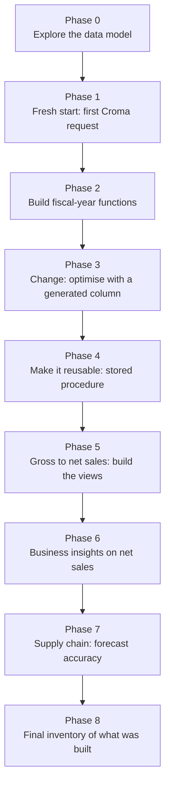

| Phase | What happened | Requests covered |
|:-:|---|---|
| [**0**](#phase-0) | Explored the 11 tables of `gdb0041` | - |
| [**1**](#phase-1) | **Fresh start:** first business request, find Croma, discover the fiscal-year problem | R1 (started) |
| [**2**](#phase-2) | Built `get_fiscal_year()` and `get_fiscal_quarter()`, then answered R1 and R2 | R1, R2 |
| [**3**](#phase-3) | **Change:** replaced per-row function calls with a generated column, then compared before and after | R1 (optimised) |
| [**4**](#phase-4) | Turned a one-off report into a reusable stored procedure | R3 |
| [**5**](#phase-5) | Built three layered views (v1, then improved v2, then post-invoice, then net sales) | - |
| [**6**](#phase-6) | Used `net_sales` to answer leadership questions | R4 to R8 |
| [**7**](#phase-7) | Forecast accuracy for Supply Chain, from temp tables to CTEs | R9 |
| [**8**](#phase-8) | Inventory of every function, view and procedure created | - |

> 📌 **Fiscal year rule used everywhere:** AtliQ's fiscal year starts in **September**. FY2021 = Sep 2020 to Aug 2021.


---

<a id="phase-0"></a>

## 🔎 Phase 0 · Know the data

Before writing any query, I opened the database **`gdb0041`** and listed its tables: **3 dimension tables** (customers, products, dates) and **8 fact tables** (sales, prices, deductions, forecasts, costs).

<p align="center">
  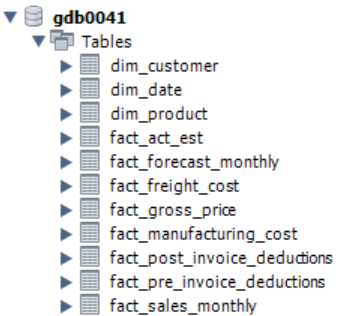<br>
  <sub><b>Figure 1</b> · The 11 tables in gdb0041</sub>
</p>

| Table | Role | Used for |
|---|---|---|
| `dim_customer` | Who bought (customer, market, region, channel) | Customer and market reports |
| `dim_product` | What was sold (product, variant) | Product reports |
| `fact_sales_monthly` | Units sold per month, product and customer | Core of every sales query |
| `fact_gross_price` | List price per product per fiscal year | Gross sales |
| `fact_pre_invoice_deductions` | Discount % before invoicing | Net invoice sales |
| `fact_post_invoice_deductions` | Discounts and other deductions after invoicing | Net sales |
| `fact_act_est` | Actual vs forecast quantity | Forecast accuracy |

**Key observation:** sales are stored by **calendar month**, but prices are stored by **fiscal year**. Joining them correctly needs a fiscal-year conversion, and that shapes the next phases.

---

<a id="phase-1"></a>

## 🚀 Phase 1 · Fresh start: the first business request

<a id="r1"></a>

### Request 1 · Croma yearly gross sales (started)

`Stakeholder: Sales`  `Technique: Joins, aggregation`

> 🎯 **Business question**
>
> *Generate a yearly report for Croma India with two columns: Fiscal Year and Total Gross Sales from Croma in that year.*

<p align="center">
  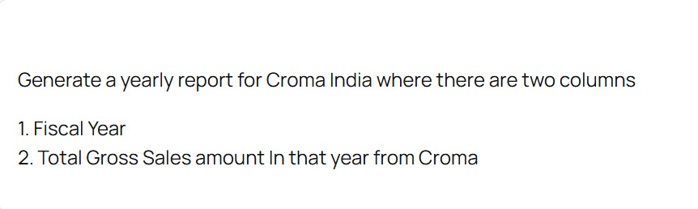<br>
  <sub><b>Figure 2</b> · The request as received</sub>
</p>

**Step 1: who is Croma?** The question names a customer, but tables use `customer_code`, so I looked Croma up first.

```sql
-- Step 1: find Croma's customer code (-> 90002002)
SELECT * FROM dim_customer WHERE customer LIKE '%Croma%';
```

<p align="center">
  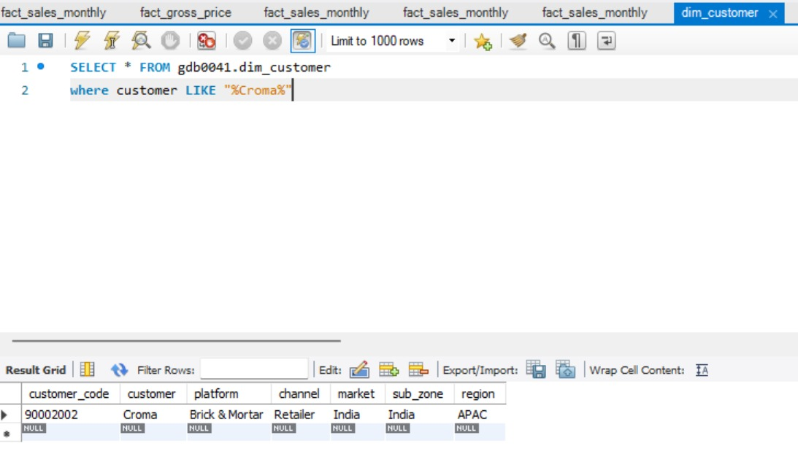<br>
  <sub><b>Figure 3</b> · Croma = customer_code 90002002, market India, channel Retailer</sub>
</p>

> ✅ **Answer so far:** Croma's code is **90002002** (Brick & Mortar, Retailer, India, APAC).

**Step 2: the obstacle.** Gross sales = `gross_price × sold_quantity`, but `fact_sales_monthly` only has a calendar `date`, while `fact_gross_price` is keyed by `fiscal_year`. I need a reliable way to turn a date into a fiscal year, so I build that next.

---

<a id="phase-2"></a>

## 🧰 Phase 2 · Build the fiscal-year toolkit

Fiscal year starts in September, so shifting any date forward by **4 months** gives the correct fiscal year and quarter. I wrapped this once in two functions so no query repeats the logic.

```sql
USE gdb0041;

DROP FUNCTION IF EXISTS get_fiscal_year;
DROP FUNCTION IF EXISTS get_fiscal_quarter;

DELIMITER $$

CREATE FUNCTION get_fiscal_year(calendar_date DATE)
RETURNS INT
DETERMINISTIC
BEGIN
    RETURN YEAR(DATE_ADD(calendar_date, INTERVAL 4 MONTH));
END$$

CREATE FUNCTION get_fiscal_quarter(calendar_date DATE)
RETURNS INT
DETERMINISTIC
BEGIN
    RETURN QUARTER(DATE_ADD(calendar_date, INTERVAL 4 MONTH));
END$$

DELIMITER ;

-- Quick test
SELECT get_fiscal_year('2020-09-01')    AS fy,   -- 2021
       get_fiscal_quarter('2020-09-01') AS fq;   -- 1
```

<p align="center">
  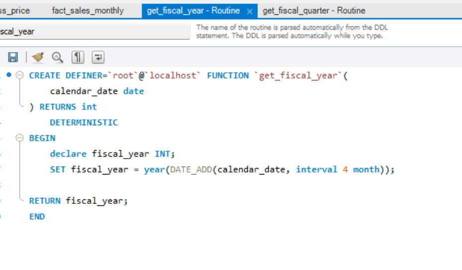<br>
  <sub><b>Figure 4</b> · get_fiscal_year(): date + 4 months, then YEAR()</sub>
</p>

<p align="center">
  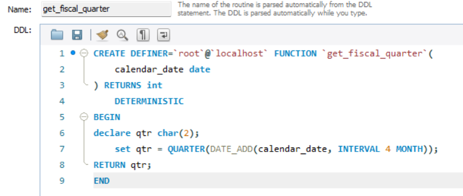<br>
  <sub><b>Figure 5</b> · get_fiscal_quarter(): date + 4 months, then QUARTER()</sub>
</p>

> 🛠 **Cleanup note:** the original `get_fiscal_quarter` declared its variable as `CHAR(2)` while returning `INT`. In the repo version the variable is `INT`, so the types match.

### Request 1 · Croma yearly gross sales (completed)

**Approach:** join sales to gross price on product **and** fiscal year, multiply price by quantity, and group by fiscal year.

```sql
-- Version A: using the fiscal-year function (works on any table)
SELECT
    get_fiscal_year(s.date)                        AS fiscal_year,
    ROUND(SUM(g.gross_price * s.sold_quantity), 2) AS total_gross_sales
FROM fact_sales_monthly s
JOIN fact_gross_price g
    ON  g.product_code = s.product_code
    AND g.fiscal_year  = get_fiscal_year(s.date)
WHERE s.customer_code = 90002002
GROUP BY fiscal_year
ORDER BY fiscal_year;
```

<p align="center">
  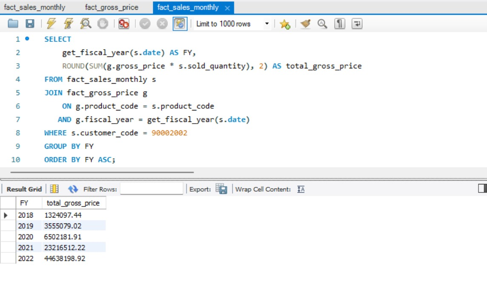<br>
  <sub><b>Figure 6</b> · Croma yearly gross sales (Version A, using the function)</sub>
</p>

**✅ Answer**

| Fiscal Year | Total Gross Sales |
|:-:|--:|
| 2018 | 1,324,097.44 |
| 2019 | 3,555,079.02 |
| 2020 | 6,502,181.91 |
| 2021 | 23,216,512.22 |
| 2022 | 44,638,198.92 |

> 💡 **Insight:** Croma grew about **257%** from FY2020 to FY2021 and another **~92%** in FY2022. FY2018 starts in Sep 2017, so the earliest year may cover a shorter period.


---

<a id="r2"></a>

### Request 2 · Croma transactions for Q1 FY2021

`Stakeholder: Sales`  `Technique: Multi-table joins, fiscal quarter function`

> 🎯 **Business question**
>
> *Provide a transaction-level sales report for Croma in the first fiscal quarter (September to November) of FY2021: product, variant, quantity, price per item and total gross price.*

**Approach:** join sales to `dim_product` for names and variants and to `fact_gross_price` for prices, then filter with `get_fiscal_quarter(date) = 1`.

```sql
SELECT
    s.date,
    s.product_code,
    p.product,
    p.variant,
    s.sold_quantity,
    g.gross_price                              AS gross_price_per_item,
    ROUND(g.gross_price * s.sold_quantity, 2)  AS total_gross_price
FROM fact_sales_monthly s
JOIN dim_product p
    ON p.product_code = s.product_code
JOIN fact_gross_price g
    ON  g.product_code = s.product_code
    AND g.fiscal_year  = s.fiscal_year
WHERE s.customer_code = 90002002
  AND s.fiscal_year   = 2021
  AND get_fiscal_quarter(s.date) = 1
ORDER BY s.date DESC;
```

<p align="center">
  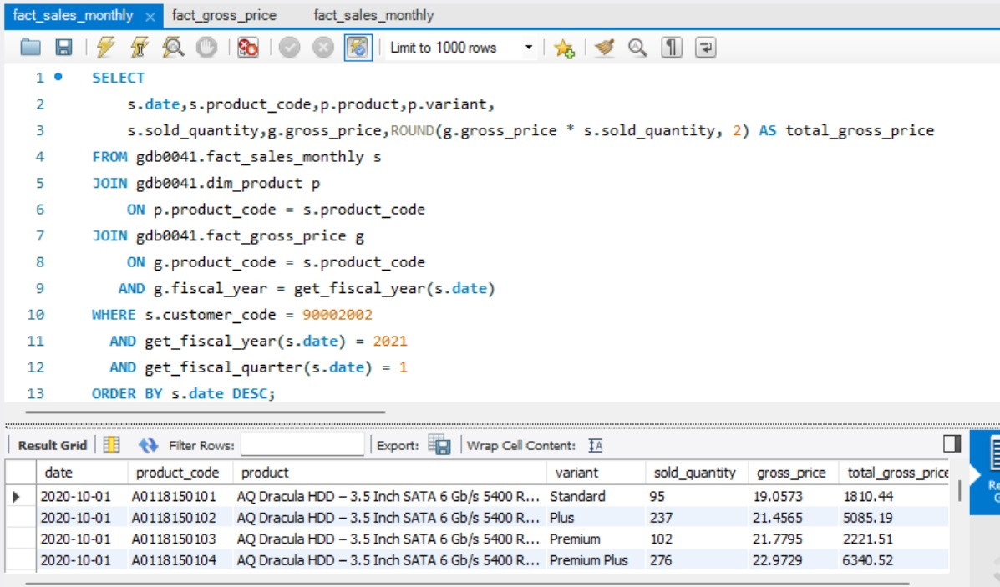<br>
  <sub><b>Figure 7</b> · Croma Q1 FY2021 transactions</sub>
</p>

**✅ Answer (first rows)**

| date | product_code | variant | sold_qty | gross_price | total_gross_price |
|---|---|---|--:|--:|--:|
| 2020-10-01 | A0118150101 | Standard | 95 | 19.0573 | 1,810.44 |
| 2020-10-01 | A0118150102 | Plus | 237 | 21.4565 | 5,085.19 |
| 2020-10-01 | A0118150103 | Premium | 102 | 21.7795 | 2,221.51 |
| 2020-10-01 | A0118150104 | Premium Plus | 276 | 22.9729 | 6,340.52 |

> 💡 **Insight:** higher-tier variants carry higher unit prices, and the high-volume variants drive most of the revenue.


---

<a id="phase-3"></a>

## ⚡ Phase 3 · The change: optimise with a generated column

The queries above call `get_fiscal_year(date)` for **every row** of a large table. That is slow and stops the database from using indexes. So I changed the design.

| | 🔴 Before | 🟢 After |
|---|---|---|
| Fiscal year comes from | A function called per row | A **generated column** stored in the table |
| Join condition | `g.fiscal_year = get_fiscal_year(s.date)` | `g.fiscal_year = s.fiscal_year` |
| Filtering and grouping | Function evaluated on each row | Plain column |
| Maintenance | Logic repeated in every query | Defined once in the table |

**The change (DDL):**

```sql
USE gdb0041;

ALTER TABLE fact_sales_monthly
    ADD COLUMN fiscal_year YEAR
    GENERATED ALWAYS AS (YEAR(DATE_ADD(`date`, INTERVAL 4 MONTH))) STORED
    AFTER `date`;
```

<p align="center">
  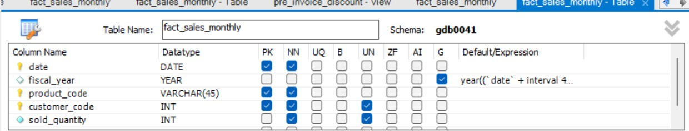<br>
  <sub><b>Figure 8</b> · fiscal_year added to fact_sales_monthly as a generated column (the G box is ticked)</sub>
</p>

**After the change:** the same Croma report becomes simpler and faster. The result is the same as the yearly report in Phase 2; only the way the fiscal year is derived changed.

```sql
-- Version B: optimised, using the generated fiscal_year column
SELECT
    s.fiscal_year,
    ROUND(SUM(g.gross_price * s.sold_quantity), 2) AS total_gross_sales
FROM fact_sales_monthly s
JOIN fact_gross_price g
    ON  g.product_code = s.product_code
    AND g.fiscal_year  = s.fiscal_year
WHERE s.customer_code = 90002002
GROUP BY s.fiscal_year
ORDER BY s.fiscal_year;
```

> ✅ From here on, every query uses `fiscal_year` directly.

---

<a id="phase-4"></a>

## 🔁 Phase 4 · Make it reusable: a stored procedure

<a id="r3"></a>

### Request 3 · Croma monthly gross sales

`Stakeholder: Sales / Finance`  `Technique: Stored procedure, FIND_IN_SET`

> 🎯 **Business question**
>
> *Provide a monthly gross sales report for Croma, and make it reusable for any customer or group of customers.*

**Step 1: the ad hoc query.** Aggregate gross sales by month for Croma.

```sql
-- Ad hoc query
SELECT
    s.date,
    ROUND(SUM(g.gross_price * s.sold_quantity), 2) AS total_gross_price
FROM fact_sales_monthly s
JOIN fact_gross_price g
    ON  g.product_code = s.product_code
    AND g.fiscal_year  = s.fiscal_year
WHERE s.customer_code = 90002002
GROUP BY s.date
ORDER BY s.date ASC;
```

<p align="center">
  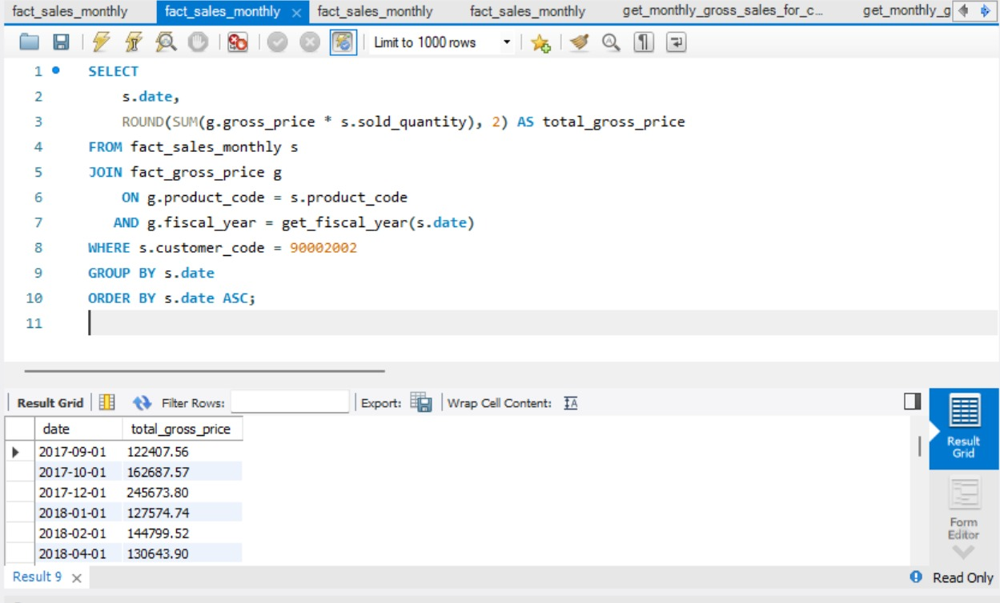<br>
  <sub><b>Figure 9</b> · Croma monthly gross sales (ad hoc query)</sub>
</p>

**The change:** a hard-coded customer code limits the query to one customer. I wrapped it in a **stored procedure** that takes a comma-separated list of customer codes, so anyone can run it for one or many customers.

```sql
DELIMITER $$

CREATE PROCEDURE get_monthly_gross_sales_for_customer (
    IN in_customer_codes TEXT
)
BEGIN
    SELECT
        s.date,
        ROUND(SUM(g.gross_price * s.sold_quantity), 2) AS total_gross_price
    FROM fact_sales_monthly s
    JOIN fact_gross_price g
        ON  g.product_code = s.product_code
        AND g.fiscal_year  = s.fiscal_year
    WHERE FIND_IN_SET(s.customer_code, in_customer_codes) > 0
    GROUP BY s.date
    ORDER BY s.date ASC;
END$$

DELIMITER ;
```

<p align="center">
  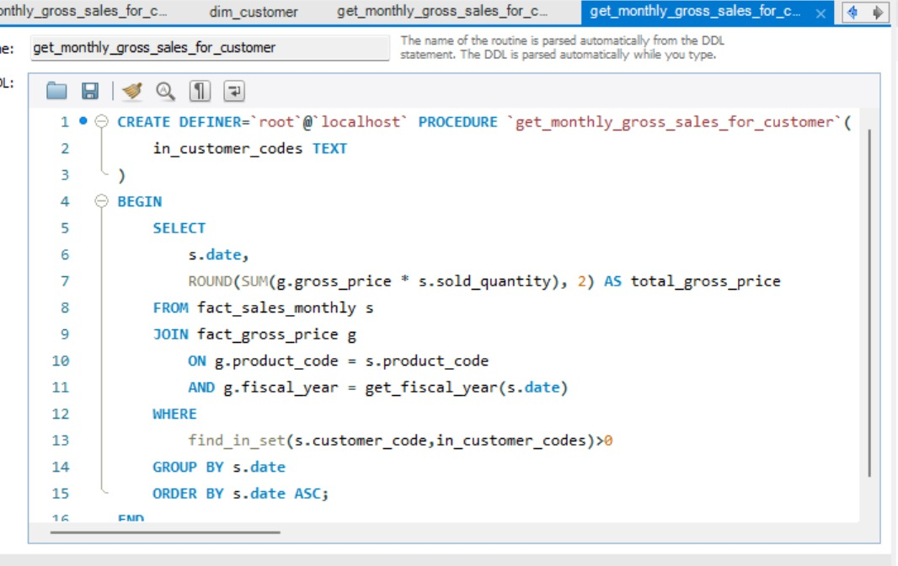<br>
  <sub><b>Figure 10</b> · Procedure definition: get_monthly_gross_sales_for_customer</sub>
</p>

<p align="center">
  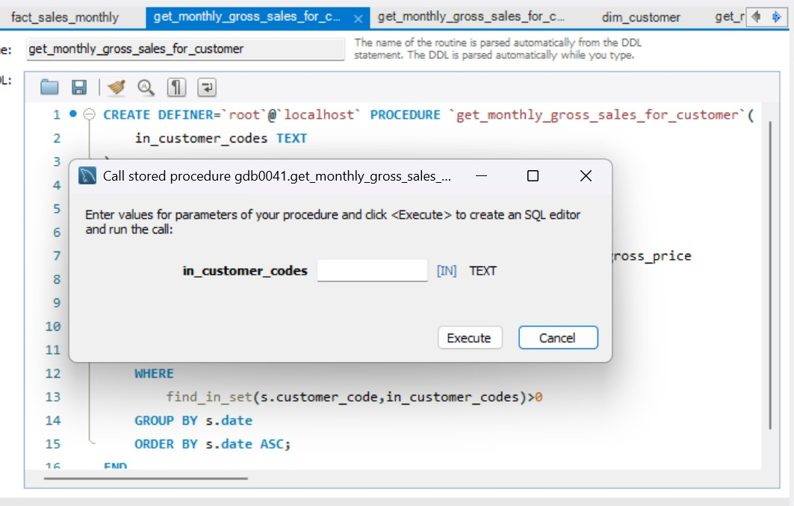<br>
  <sub><b>Figure 11</b> · Calling the procedure from MySQL Workbench: enter customer codes</sub>
</p>

```sql
-- Reusable version: stored procedure (accepts one or many customer codes)
CALL get_monthly_gross_sales_for_customer('90002002');
```

<p align="center">
  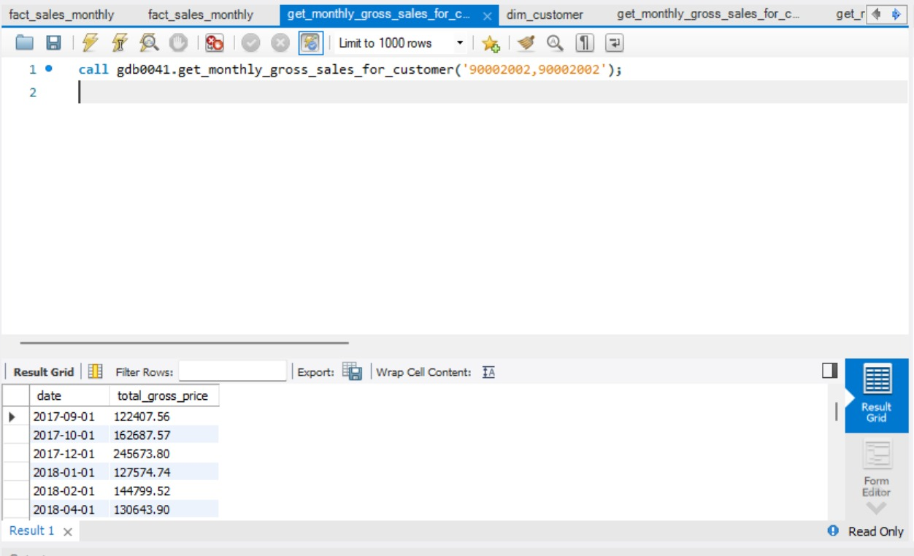<br>
  <sub><b>Figure 12</b> · Procedure output: same result, now reusable</sub>
</p>

**✅ Answer (first rows)**

| date | total_gross_price |
|---|--:|
| 2017-09-01 | 122,407.56 |
| 2017-10-01 | 162,687.57 |
| 2017-12-01 | 245,673.80 |
| 2018-01-01 | 127,574.74 |
| 2018-02-01 | 144,799.52 |
| 2018-04-01 | 130,643.90 |

> 💡 **Insight:** the monthly series feeds straight into Excel for trend charts, and the procedure turns a one-off query into a self-service tool. Passing several codes, such as `'90002002,<another code>'`, returns the combined total.


---

<a id="phase-5"></a>

## 🏗 Phase 5 · From gross to net sales: building the views

Gross sales ignore discounts. Leadership needs **net sales**, which means applying the pre-invoice and post-invoice deductions. Instead of repeating long joins in every query, I built the logic **once, in three layered views**.

```
Gross Sales        = gross_price × sold_quantity
Net Invoice Sales  = Gross Sales × (1 − pre_invoice_discount_pct)
Net Sales          = Net Invoice Sales × (1 − post_invoice_discounts_pct)
```

### Step 1 · View v1: gross price + pre-invoice discount
First version: sales joined with product, gross price and the pre-invoice discount %.

<p align="center">
  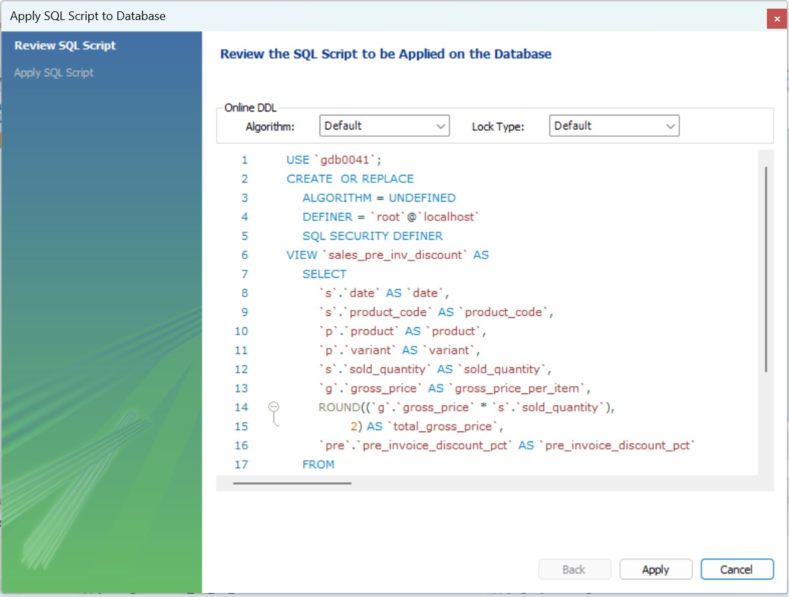<br>
  <sub><b>Figure 13</b> · sales_pre_inv_discount, version 1 (no market or fiscal_year columns yet)</sub>
</p>

**Test:** compute net invoice sales on top of the view.

```sql
SELECT *,
       (1 - pre_invoice_discount_pct) * total_gross_price AS net_invoice_sales
FROM gdb0041.sales_pre_inv_discount;
```

<p align="center">
  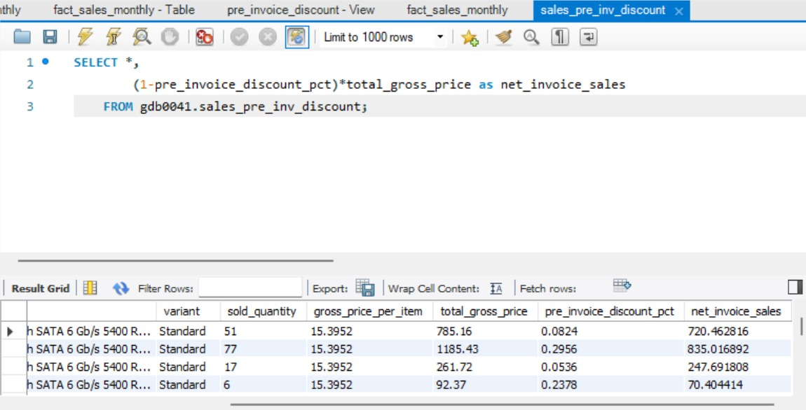<br>
  <sub><b>Figure 14</b> · Net invoice sales calculated from the v1 view</sub>
</p>

### Step 2 · The change: view v2
The next step (post-invoice deductions) joins on `customer_code`, and the business questions filter by **market** and **fiscal year**. Version 1 had none of these, so I rebuilt the view with `fiscal_year`, `customer_code` and `market`.

| | 🔴 v1 | 🟢 v2 (final) |
|---|---|---|
| Columns | date, product, variant, quantity, prices, discount % | + **fiscal_year, customer_code, market** |
| Can filter by year / market | No (extra joins needed) | Yes |
| Can join post-invoice data | No | Yes |

```sql
CREATE OR REPLACE VIEW sales_pre_inv_discount AS
SELECT
    s.date,
    s.fiscal_year,
    c.market,
    s.customer_code,
    s.product_code,
    p.product,
    p.variant,
    s.sold_quantity,
    g.gross_price                          AS gross_price_per_item,
    ROUND(g.gross_price * s.sold_quantity, 2) AS total_gross_price,
    pre.pre_invoice_discount_pct
FROM fact_sales_monthly s
JOIN dim_customer c
    ON c.customer_code = s.customer_code
JOIN dim_product p
    ON p.product_code = s.product_code
JOIN fact_gross_price g
    ON  g.product_code = s.product_code
    AND g.fiscal_year  = s.fiscal_year
JOIN fact_pre_invoice_deductions pre
    ON  pre.customer_code = s.customer_code
    AND pre.fiscal_year   = s.fiscal_year;
```

<p align="center">
  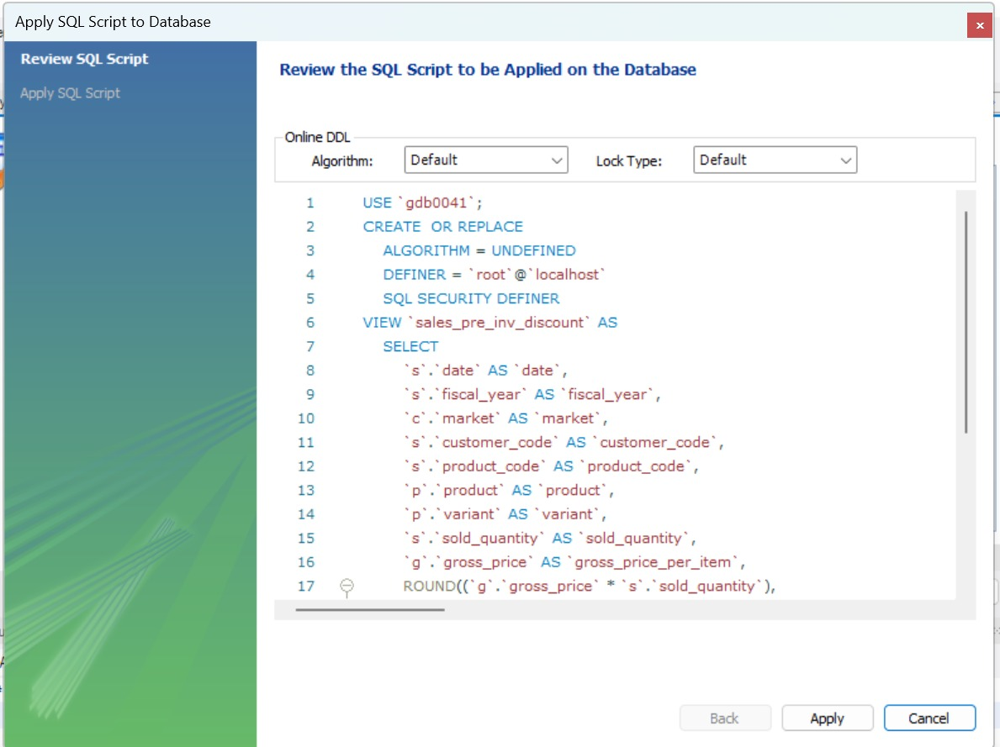<br>
  <sub><b>Figure 15</b> · sales_pre_inv_discount, version 2 (final)</sub>
</p>

### Step 3 · View: post-invoice deductions

Adds `net_invoice_sales` and combines `discounts_pct + other_deductions_pct` into one post-invoice percentage.

```sql
CREATE OR REPLACE VIEW sales_pos_inv_discount AS
SELECT
    pr.date,
    pr.fiscal_year,
    pr.customer_code,
    pr.market,
    pr.product_code,
    pr.product,
    pr.variant,
    pr.sold_quantity,
    pr.gross_price_per_item,
    pr.total_gross_price,
    pr.pre_invoice_discount_pct,
    (1 - pr.pre_invoice_discount_pct) * pr.total_gross_price AS net_invoice_sales,
    (po.discounts_pct + po.other_deductions_pct)             AS post_invoice_discounts_pct
FROM sales_pre_inv_discount pr
JOIN fact_post_invoice_deductions po
    ON  po.date          = pr.date
    AND po.product_code  = pr.product_code
    AND po.customer_code = pr.customer_code;
```

<p align="center">
  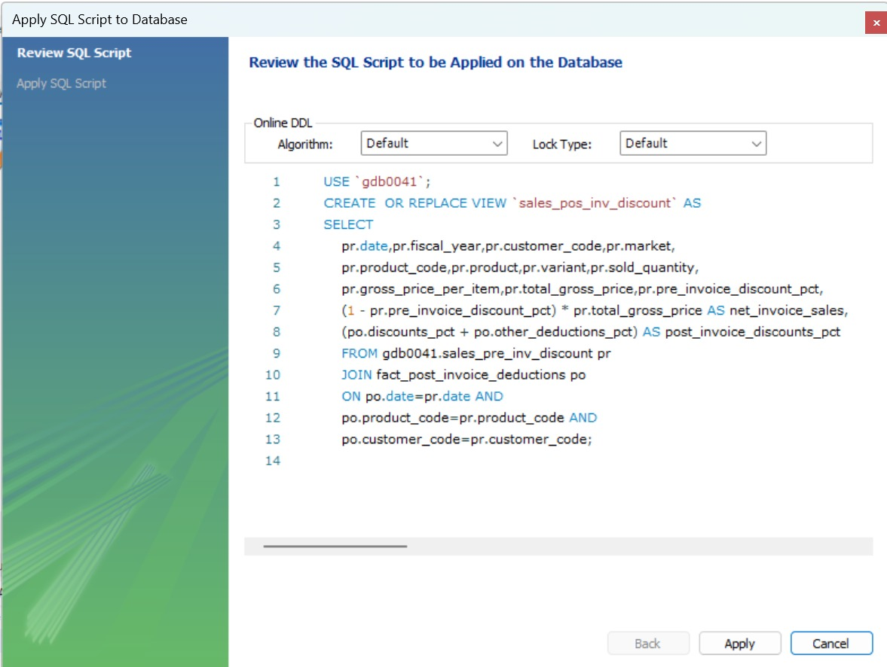<br>
  <sub><b>Figure 16</b> · sales_pos_inv_discount view</sub>
</p>

### Step 4 · View: net sales

Test the formula first, then save it as a view.

```sql
SELECT *,
       (1 - post_invoice_discounts_pct) * net_invoice_sales AS net_sales
FROM gdb0041.sales_pos_inv_discount;
```

<p align="center">
  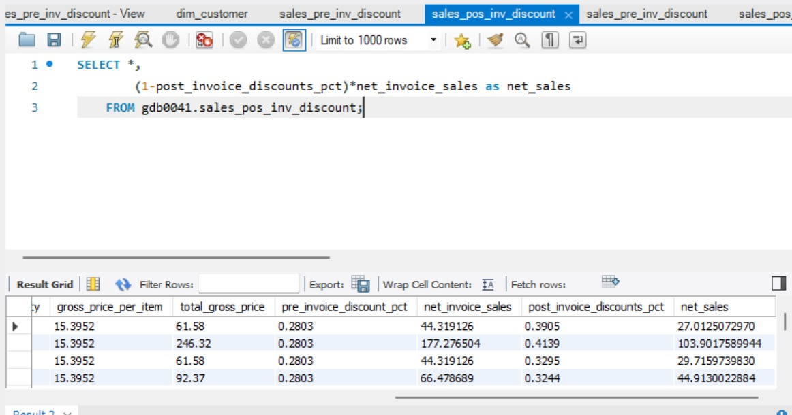<br>
  <sub><b>Figure 17</b> · Net sales calculated on top of the post-invoice view</sub>
</p>

```sql
CREATE OR REPLACE VIEW net_sales AS
SELECT
    *,
    (1 - post_invoice_discounts_pct) * net_invoice_sales AS net_sales
FROM sales_pos_inv_discount;
```

<p align="center">
  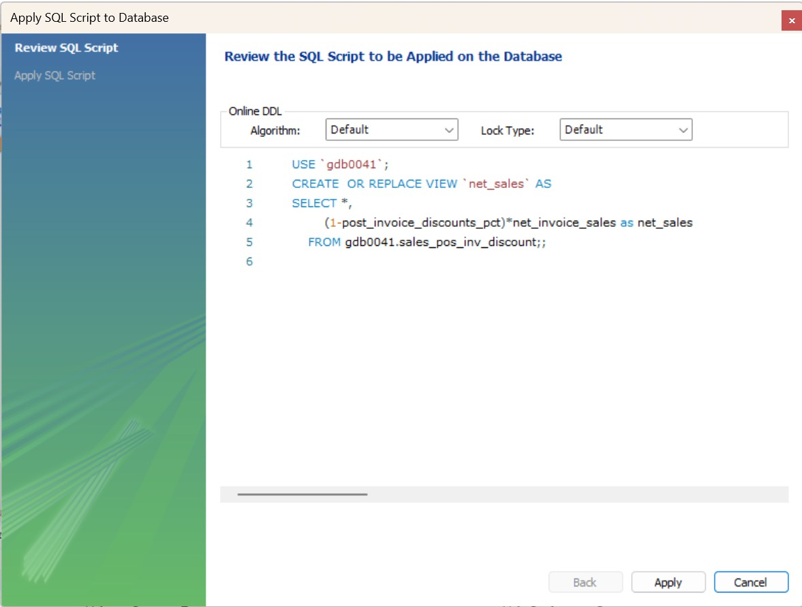<br>
  <sub><b>Figure 18</b> · net_sales view saved in the database</sub>
</p>

> ✅ **Result of Phase 5:** one clean `net_sales` view. Every insight below is a short query on top of it, with no repeated joins.

---

<a id="phase-6"></a>

## 📈 Phase 6 · Business insights on net sales

<a id="r4"></a>

### Request 4 · Top 5 markets by net sales (FY2021)

`Stakeholder: Leadership`  `Technique: View, GROUP BY, LIMIT`

> 🎯 **Business question**
>
> *Which five markets generated the most net sales in FY2021?*

**Approach:** filter the `net_sales` view to FY2021, group by market, sort descending and keep five.

```sql
SELECT
    market,
    ROUND(SUM(net_sales) / 1000000, 2) AS net_sales_mln
FROM net_sales
WHERE fiscal_year = 2021
GROUP BY market
ORDER BY net_sales_mln DESC
LIMIT 5;
```

<p align="center">
  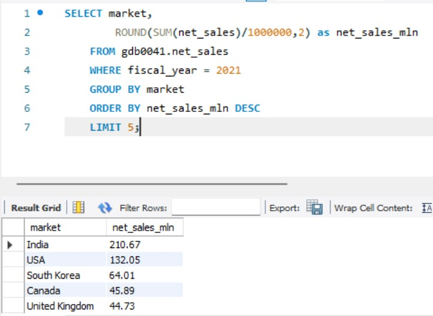<br>
  <sub><b>Figure 19</b> · Top 5 markets by net sales, FY2021</sub>
</p>

**✅ Answer**

| Rank | Market | Net Sales (M) |
|:-:|---|--:|
| 1 | India | 210.67 |
| 2 | USA | 132.05 |
| 3 | South Korea | 64.01 |
| 4 | Canada | 45.89 |
| 5 | United Kingdom | 44.73 |

> 💡 **Insight:** India out-earns the USA by about **60%**, so discount and growth strategy there moves total net revenue the most.


---

<a id="r5"></a>

### Request 5 · Top 5 customers by net sales (FY2021)

`Stakeholder: Key Accounts`  `Technique: Join, GROUP BY, LIMIT`

> 🎯 **Business question**
>
> *Who are our five largest customers by net sales in FY2021?*

**Approach:** join `net_sales` to `dim_customer` for names, filter to FY2021, group by customer.

```sql
SELECT
    c.customer,
    ROUND(SUM(n.net_sales) / 1000000, 2) AS net_sales_mln
FROM net_sales n
JOIN dim_customer c
    ON c.customer_code = n.customer_code
WHERE n.fiscal_year = 2021
GROUP BY c.customer
ORDER BY net_sales_mln DESC
LIMIT 5;
```

<p align="center">
  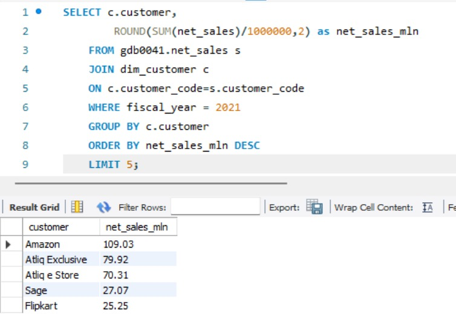<br>
  <sub><b>Figure 20</b> · Top 5 customers by net sales, FY2021</sub>
</p>

**✅ Answer**

| Rank | Customer | Net Sales (M) |
|:-:|---|--:|
| 1 | Amazon | 109.03 |
| 2 | Atliq Exclusive | 79.92 |
| 3 | Atliq e Store | 70.31 |
| 4 | Sage | 27.07 |
| 5 | Flipkart | 25.25 |

> 💡 **Insight:** the top three accounts (**$259.3M**) are more than 3× the next two combined, and two of them are AtliQ's own channels.
>
> ⚠️ **Data note:** customers are grouped by *name*, so one that operates in several markets (e.g. Amazon) appears as a single line. Group by `customer_code` for a per-market split.


---

<a id="r6"></a>

### Request 6 · Customer contribution to net sales

`Stakeholder: Finance`  `Technique: CTE, window function SUM() OVER()`

> 🎯 **Business question**
>
> *What percentage of total net sales does each customer contribute? Show the top customers in a bar chart.*

**Approach:** total net sales per customer in a CTE, then `SUM(net_sales) OVER ()` gives the grand total so each share is `customer ÷ total`. Percentages use **unrounded** values to avoid rounding drift.

```sql
WITH customer_sales AS (
    SELECT
        c.customer,
        SUM(n.net_sales) AS net_sales
    FROM net_sales n
    JOIN dim_customer c
        ON c.customer_code = n.customer_code
    GROUP BY c.customer
)
SELECT
    customer,
    ROUND(net_sales / 1000000, 2)                  AS net_sales_mln,
    ROUND(net_sales * 100 / SUM(net_sales) OVER (), 2) AS pct_contribution
FROM customer_sales
ORDER BY net_sales DESC;
```

<p align="center">
  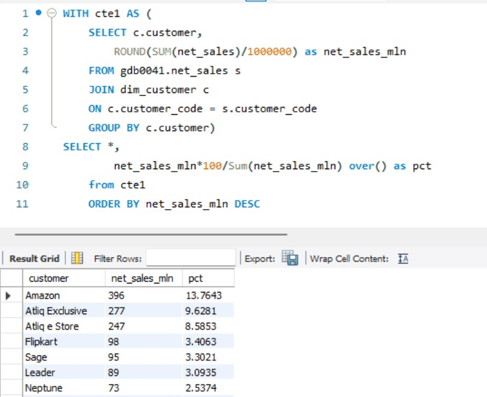<br>
  <sub><b>Figure 21</b> · SQL output: net sales and % contribution per customer</sub>
</p>

**Visualisation:** the result was exported to Excel and charted as a horizontal bar chart.

<p align="center">
  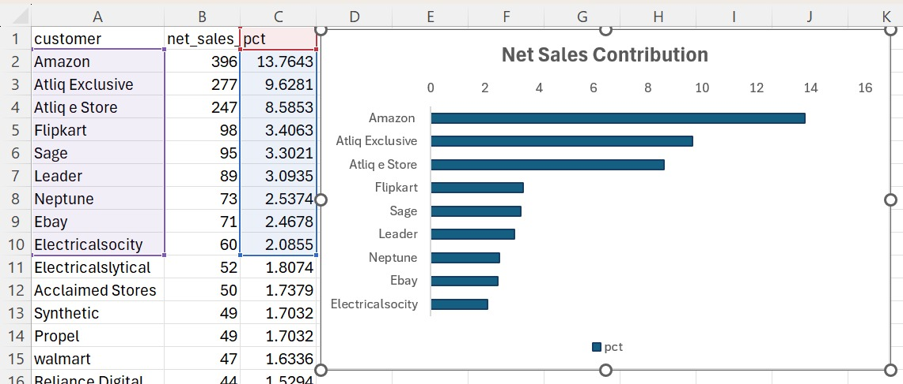<br>
  <sub><b>Figure 22</b> · Excel bar chart: net sales contribution by customer</sub>
</p>

**✅ Answer**

| Customer | Net Sales (M) | % of total |
|---|--:|--:|
| Amazon | 396 | 13.76 |
| Atliq Exclusive | 277 | 9.63 |
| Atliq e Store | 247 | 8.59 |
| Flipkart | 98 | 3.41 |
| Sage | 95 | 3.30 |
| Leader | 89 | 3.09 |
| Neptune | 73 | 2.54 |
| Ebay | 71 | 2.47 |
| Electricalsocity | 60 | 2.09 |

> 💡 **Insight:** the nine customers in the chart contribute about **48.9%** of net sales. Amazon is the largest single customer at 13.76%, but AtliQ's own two channels together (**~18.2%**) are larger.


---

<a id="r7"></a>

### Request 7 · Top 2 markets in every region

`Stakeholder: Regional Heads`  `Technique: CTE, DENSE_RANK() with PARTITION BY`

> 🎯 **Business question**
>
> *Retrieve the top 2 markets in every region by gross sales in FY2021.*

**Approach:** a plain `LIMIT` cannot return "top 2 per group". `DENSE_RANK() OVER (PARTITION BY region ORDER BY sales DESC)` ranks markets inside each region, and the outer query keeps ranks 1 and 2.

```sql
WITH market_sales AS (
    SELECT
        c.region,
        n.market,
        ROUND(SUM(n.total_gross_price) / 1000000, 2) AS gross_sales_mln,
        DENSE_RANK() OVER (
            PARTITION BY c.region
            ORDER BY SUM(n.total_gross_price) DESC
        ) AS rank_in_region
    FROM net_sales n
    JOIN dim_customer c
        ON c.customer_code = n.customer_code
    WHERE n.fiscal_year = 2021
    GROUP BY c.region, n.market
)
SELECT *
FROM market_sales
WHERE rank_in_region <= 2
ORDER BY region, rank_in_region;
```

<p align="center">
  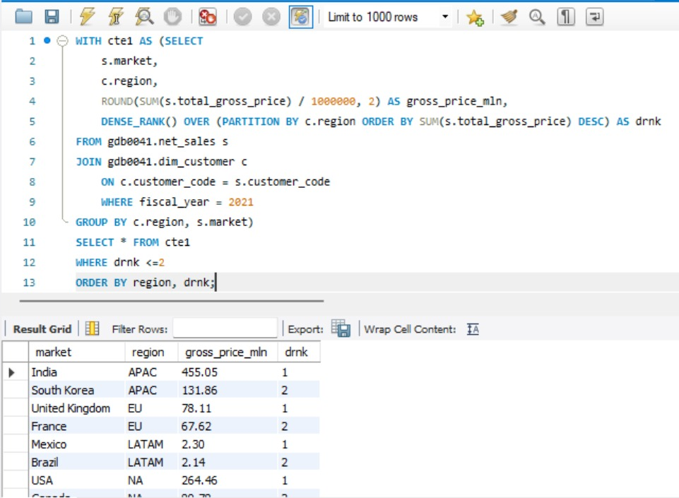<br>
  <sub><b>Figure 23</b> · Top 2 markets per region by gross sales, FY2021</sub>
</p>

**✅ Answer**

| Region | Rank 1 | Rank 2 |
|---|---|---|
| APAC | India (455.05M) | South Korea (131.86M) |
| EU | United Kingdom (78.11M) | France (67.62M) |
| LATAM | Mexico (2.30M) | Brazil (2.14M) |
| NA | USA (264.46M) | Canada |

> 💡 **Insight:** APAC and NA carry the volume, while LATAM is tiny by comparison, so it is either an untapped opportunity or a low-priority region depending on strategy.


---

<a id="r8"></a>

### Request 8 · Top N products by net sales (stored procedure)

`Stakeholder: Product Team`  `Technique: Parameterised stored procedure`

> 🎯 **Business question**
>
> *Write a stored procedure that returns the top N products by net sales for a given fiscal year. Use the product name without the variant.*

**Approach:** a procedure with two inputs, `in_fiscal_year` and `in_top_n`. It groups `net_sales` by **product name only**, so all variants roll up into one product.

```sql
DELIMITER $$

CREATE PROCEDURE get_top_n_products_by_fy (
    IN in_fiscal_year INT,
    IN in_top_n       INT
)
BEGIN
    SELECT
        product,
        ROUND(SUM(net_sales) / 1000000, 2) AS net_sales_mln
    FROM net_sales
    WHERE fiscal_year = in_fiscal_year
    GROUP BY product
    ORDER BY net_sales_mln DESC
    LIMIT in_top_n;
END$$

DELIMITER ;
```

<p align="center">
  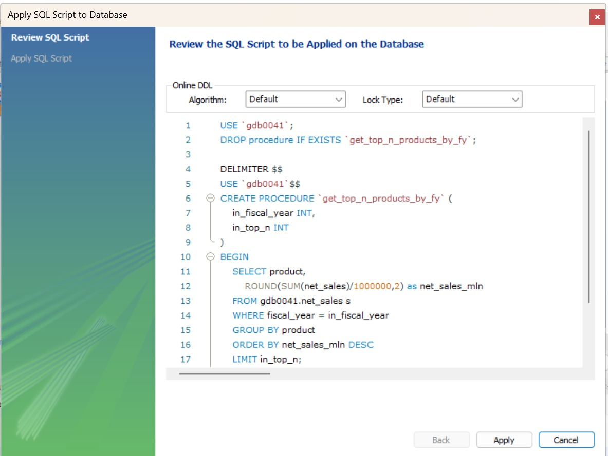<br>
  <sub><b>Figure 24</b> · Procedure definition: get_top_n_products_by_fy</sub>
</p>

<p align="center">
  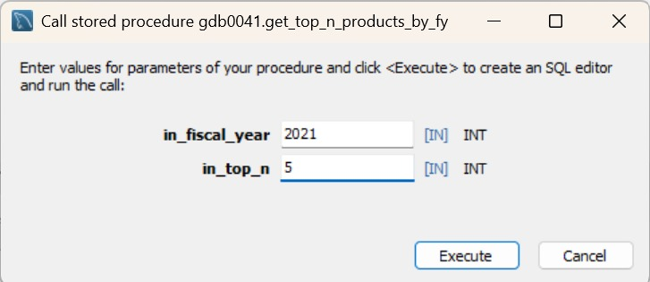<br>
  <sub><b>Figure 25</b> · Calling the procedure: fiscal year 2021, top 5</sub>
</p>

```sql
CALL get_top_n_products_by_fy(2021, 5);
```

<p align="center">
  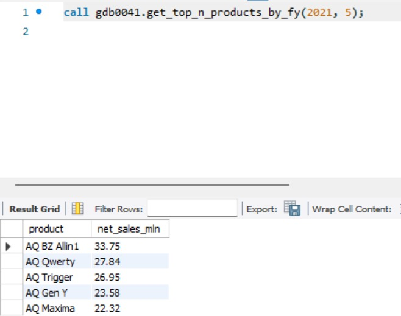<br>
  <sub><b>Figure 26</b> · Top 5 products by net sales, FY2021</sub>
</p>

**✅ Answer**

| Rank | Product | Net Sales (M) |
|:-:|---|--:|
| 1 | AQ BZ Allin1 | 33.75 |
| 2 | AQ Qwerty | 27.84 |
| 3 | AQ Trigger | 26.95 |
| 4 | AQ Gen Y | 23.58 |
| 5 | AQ Maxima | 22.32 |

> 💡 **Insight:** changing two parameters gives any year and any N with no query rewriting. AQ BZ Allin1 leads FY2021 at **$33.75M**.


---

<a id="phase-7"></a>

## 📦 Phase 7 · Supply chain: forecast accuracy

<a id="r9"></a>

### Request 9 · Forecast accuracy report

`Stakeholder: Supply Chain`  `Technique: CTEs, self-join, error metrics`

> 🎯 **Business question**
>
> *Which customers' forecast accuracy dropped from 2020 to 2021? Provide customer_code, customer_name, market, forecast_accuracy_2020 and forecast_accuracy_2021.*

**Metric definitions**

| Metric | Formula | Meaning |
|---|---|---|
| Net error | forecast − actual | Positive = over-forecast (excess-inventory risk) |
| Absolute error % | Σ\|forecast − actual\| ÷ Σforecast | Size of the miss, ignoring direction |
| **Forecast accuracy** | 100 − absolute error % (floored at 0) | Higher is better |

### Part A · FY2021 forecast accuracy report (first version)
My first version used a **temporary table**. It worked, but the FY2020 and FY2021 logic had to be copy-pasted twice.

<p align="center">
  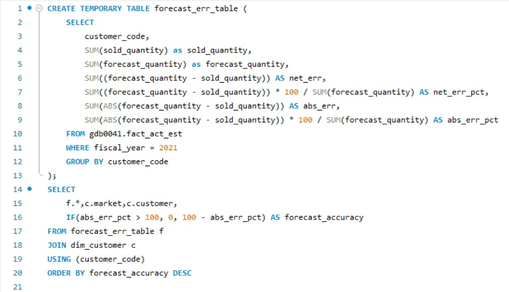<br>
  <sub><b>Figure 27</b> · First version: temporary table with FY2021 error metrics</sub>
</p>

**The change:** one **CTE** grouped by fiscal year now covers both years. It adds a `NULLIF` guard against division by zero and groups by every selected column.

```sql
-- Part A: customer-level forecast accuracy report for FY2021
WITH forecast_error AS (
    SELECT
        s.customer_code,
        c.customer,
        c.market,
        SUM(s.sold_quantity)     AS sold_quantity,
        SUM(s.forecast_quantity) AS forecast_quantity,
        SUM(s.forecast_quantity - s.sold_quantity) AS net_err,
        SUM(s.forecast_quantity - s.sold_quantity) * 100
            / NULLIF(SUM(s.forecast_quantity), 0)  AS net_err_pct,
        SUM(ABS(s.forecast_quantity - s.sold_quantity)) AS abs_err,
        SUM(ABS(s.forecast_quantity - s.sold_quantity)) * 100
            / NULLIF(SUM(s.forecast_quantity), 0)  AS abs_err_pct
    FROM fact_act_est s
    JOIN dim_customer c
        ON c.customer_code = s.customer_code
    WHERE s.fiscal_year = 2021
    GROUP BY s.customer_code, c.customer, c.market
)
SELECT
    *,
    GREATEST(0, 100 - abs_err_pct) AS forecast_accuracy
FROM forecast_error
ORDER BY forecast_accuracy DESC;
```

<p align="center">
  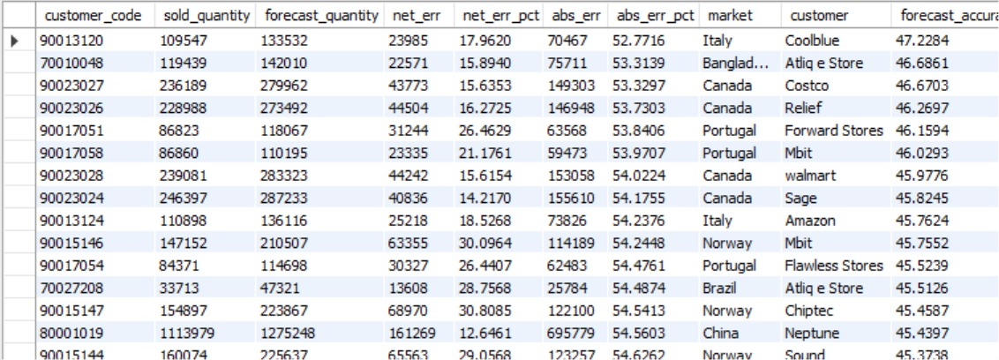<br>
  <sub><b>Figure 28</b> · FY2021 forecast accuracy per customer, sorted from best to worst</sub>
</p>

**✅ Answer (top of the report)**

| Customer | Market | Net err % | Abs err % | Forecast accuracy |
|---|---|--:|--:|--:|
| Coolblue | Italy | 17.96 | 52.78 | 47.23 |
| Atliq e Store | Bangladesh | 15.89 | 53.31 | 46.69 |
| Costco | Canada | 15.64 | 53.33 | 46.67 |
| Relief | Canada | 16.27 | 53.73 | 46.23 |
| Forward Stores | Portugal | 26.46 | 53.84 | 46.16 |

> 💡 **Insight:** even the best-forecasted customers reach only about **47% accuracy**, and every customer shown **over-forecasts**. Supply Chain should review these accounts to reduce excess-inventory risk.

### Part B · Customers whose accuracy dropped (FY2020 → FY2021)
Compute accuracy for both years once, self-join FY2020 to FY2021 on `customer_code`, and keep only customers whose accuracy **fell**.

```sql
-- Part B: customers whose forecast accuracy DROPPED from FY2020 to FY2021
--   Output: customer_code, customer_name, market,
--           forecast_accuracy_2020, forecast_accuracy_2021
WITH forecast_error AS (
    SELECT
        s.fiscal_year,
        s.customer_code,
        c.customer AS customer_name,
        c.market,
        SUM(ABS(s.forecast_quantity - s.sold_quantity)) * 100.0
            / NULLIF(SUM(s.forecast_quantity), 0) AS abs_err_pct
    FROM fact_act_est s
    JOIN dim_customer c
        ON c.customer_code = s.customer_code
    WHERE s.fiscal_year IN (2020, 2021)
    GROUP BY s.fiscal_year, s.customer_code, c.customer, c.market
),
forecast_accuracy AS (
    SELECT *, GREATEST(0, 100 - abs_err_pct) AS forecast_accuracy
    FROM forecast_error
)
SELECT
    fa20.customer_code,
    fa20.customer_name,
    fa20.market,
    ROUND(fa20.forecast_accuracy, 2) AS forecast_accuracy_2020,
    ROUND(fa21.forecast_accuracy, 2) AS forecast_accuracy_2021
FROM forecast_accuracy fa20
JOIN forecast_accuracy fa21
    ON  fa20.customer_code = fa21.customer_code
    AND fa20.fiscal_year   = 2020
    AND fa21.fiscal_year   = 2021
WHERE fa21.forecast_accuracy < fa20.forecast_accuracy
ORDER BY forecast_accuracy_2020 DESC;
```

<!-- ADD YOUR OUTPUT SCREENSHOT HERE
<p align="center"></p>
-->
**✅ Answer:** the query returns every customer whose FY2021 forecast accuracy is lower than FY2020, with both values side by side, sorted by FY2020 accuracy.


---

<a id="phase-8"></a>

## 🧾 Phase 8 · Everything that was built

Final inventory of the objects created in `gdb0041`, as shown in MySQL Workbench.

<p align="center">
  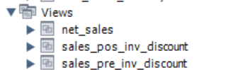<br>
  <sub><b>Figure 29</b> · Views: net_sales, sales_pos_inv_discount, sales_pre_inv_discount</sub>
</p>

<p align="center">
  <br>
  <sub><b>Figure 30</b> · Stored procedures: get_monthly_gross_sales_for_customer, get_top_n_products_by_fy</sub>
</p>

<p align="center">
  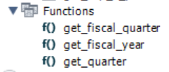<br>
  <sub><b>Figure 31</b> · Functions: get_fiscal_quarter, get_fiscal_year, get_quarter</sub>
</p>

| Object type | Name | Purpose |
|---|---|---|
| Function | `get_fiscal_year` | Date → fiscal year |
| Function | `get_fiscal_quarter` | Date → fiscal quarter |
| Generated column | `fact_sales_monthly.fiscal_year` | Fast, stored fiscal year |
| View | `sales_pre_inv_discount` | Gross price + pre-invoice discount % |
| View | `sales_pos_inv_discount` | Adds net invoice sales + post-invoice deductions % |
| View | `net_sales` | Final net sales per row |
| Procedure | `get_monthly_gross_sales_for_customer` | Monthly gross sales for any customers |
| Procedure | `get_top_n_products_by_fy` | Top N products for any year |

## 🎓 What I learned

1. **Design once, reuse everywhere:** functions, a generated column and views removed repeated logic.
2. **Measure before optimising:** moving the fiscal year out of a per-row function made queries simpler and faster.
3. **Window functions solve "top N per group"**, which `LIMIT` cannot.
4. **Business context matters:** half of gross sales disappears into discounts, and forecasts over-estimate demand. Those findings come from the *questions*, not just the SQL.

---

<p align="center">⬅️ <a href="../README.md">Back to README</a></p>
